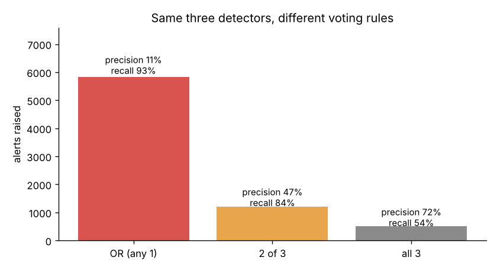

# Corporate Transaction Anomaly Detection (3-Detector Ensemble)

Flags unusual corporate banking transactions with three unsupervised detectors (**Isolation Forest**, **DBSCAN** and **statistical rules**). A transaction is only raised when **at least 2 of the 3 agree**, which cuts alert noise sharply compared with the original "any detector fires" rule.

> **About the data.** This is a public re-implementation of anomaly-detection work I reviewed and fixed at a commercial bank. Transaction data is **not** in this repo. The code runs on synthetic corporate transactions with **injected, labelled anomalies** (large amounts, odd hours, new-counterparty payments, bursts, threshold structuring), so the effect of each fix can be measured. The "In production" section describes the real work. Results after it come from the synthetic data.



## In production (the real work)

Short engagement on anomaly and fraud detection for corporate banking customers:

| | |
|---|---|
| **Reviewed** | A supervised fraud-detection script (**LSTM / Conv1D**) and a transaction-anomaly notebook (**Isolation Forest + DBSCAN + statistical**, combined with an **OR** rule, on **PySpark / Oracle**) |
| **Priority fix** | Replaced the OR-based ensemble with **agreement-threshold voting**: flag only when **≥ 2 of 3** detectors agree |
| **Tuning** | Added a **k-distance elbow plot** to choose DBSCAN `eps`, and a **contamination sweep** for Isolation Forest |
| **Validation** | Added a **precision / recall / F1 / AUC** validation script |

All four are reproduced here, on scikit-learn instead of PySpark.

## Results on the synthetic reproduction

65,911 transactions, 673 labelled anomalies (1.0%).

| Rule | Alerts | Precision | Recall | F1 |
|---|---|---|---|---|
| Isolation Forest alone | 660 | 67% | 66% | 0.66 |
| DBSCAN alone | 2,010 | 28% | 84% | 0.42 |
| Statistical alone | 4,867 | 11% | 81% | 0.20 |
| **OR: any detector (original)** | **5,825** | **11%** | 93% | 0.19 |
| **2 of 3 (fix)** | **1,206** | **47%** | **84%** | **0.60** |
| All 3 | 506 | 72% | 54% | 0.62 |

**The fix cuts alerts by 79% and raises precision 4.4×**, while still catching 84% of anomalies. The vote count used as a score gives AUC 0.954.

**Recall by anomaly type (2 of 3):** structuring 100%, odd hour 98%, large amount 98%, new counterparty + large 77%, burst 72%. Bursts are hardest because each payment looks normal on its own. Sequence-level features (the LSTM/Conv1D direction) are the natural next step.

## Run it

```bash
pip install -r requirements.txt
python run_pipeline.py
```

## Repo layout

```
data/generate_synthetic.py   corporate transactions + 5 injected anomaly types
sql/01_txn_features.sql      client-relative features (robust z, hour z, velocity, new counterparty, threshold)
src/detectors.py             IForest, DBSCAN, rules; k-distance elbow; contamination sweep; voting; metrics
run_pipeline.py
notebooks/walkthrough.ipynb
```

## Author

**Oluwasemilore Sadare**, Senior Data Scientist · [LinkedIn](https://www.linkedin.com/in/oluwasemilore-sadare) · [GitHub](https://github.com/SMLRE)
